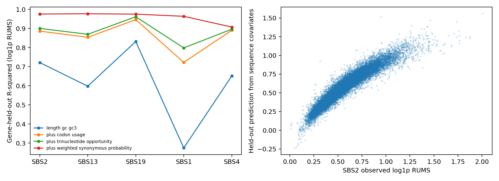
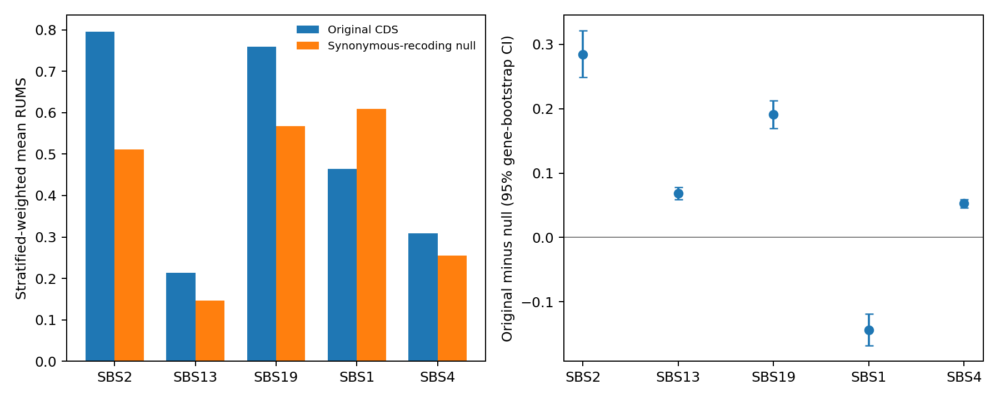

# Completed human composition and codon-null analyses

Both analyses passed. The original paper outputs and package are unchanged.
The extra null simulation uses 500 paths per sequence/profile; the original
human calculation used 1,000. These results are additional analyses.

## Joint sequence-composition models

All 19,309 fixed human gene representatives were used. The table reports
five-fold gene-held-out R-squared for log(1 + RUMS). The length/GC model
contains log CDS length, total GC and GC3. The full composition model adds
64 codon frequencies and 64 CDS-centered trinucleotide frequencies. The
last model additionally includes exact initial weighted synonymous probability.

| Profile | Length, GC, GC3 | Full composition | Plus weighted synonymous probability |
|---|---:|---:|---:|
| SBS2 | 0.7217 | 0.9005 | 0.9759 |
| SBS13 | 0.5980 | 0.8697 | 0.9772 |
| SBS19 | 0.8317 | 0.9615 | 0.9753 |
| SBS1 | 0.2746 | 0.7984 | 0.9639 |
| SBS4 | 0.6515 | 0.8964 | 0.9076 |

The complete metrics include raw-RUMS sensitivity results. SVD resolves
structural dependencies among the composition variables; individual
coefficients are not interpreted. Predictive R-squared and residual-rank
associations do not identify causal contributions or establish adaptation.



## Protein-preserving synonymous-codon null

Six genes were sampled in each of 16 length-by-GC3 quartile strata, without
using RUMS values (96 representatives total). Each original sequence and 20
uniform synonymous recodings received 500 paths for each of five profiles:
5,040,000 new trajectories. Protein sequence, stop-symbol positions, CDS
length and flanks are preserved. GC, GC3, codon and context composition may
change. Strata are weighted by the full representative-cohort proportions.

| Profile | Original mean | Null mean | Original minus null | 95% gene-bootstrap CI |
|---|---:|---:|---:|---|
| SBS2 | 0.7960 | 0.5117 | 0.2843 | [0.2488, 0.3212] |
| SBS13 | 0.2140 | 0.1460 | 0.0681 | [0.0586, 0.0782] |
| SBS19 | 0.7594 | 0.5682 | 0.1912 | [0.1697, 0.2130] |
| SBS1 | 0.4649 | 0.6088 | -0.1438 | [-0.1681, -0.1190] |
| SBS4 | 0.3084 | 0.2558 | 0.0526 | [0.0461, 0.0590] |

The original column uses fresh 500-path estimates for the 96 selected genes;
it is not the full original transcript-cohort mean. Differences from the saved
1,000-path estimates for the same genes are recorded in the summary table.

Confidence intervals use 10,000 gene resamples within selection strata.
Paths and recodings are not treated as independent genes. The intervals
use the finite simulation estimates as gene-level observations; the summary
also reports a separate conditional path/recoding Monte Carlo SE.

| Comparison of excesses | SBS2 excess minus comparison excess | Bonferroni-adjusted CI (four comparisons) |
|---|---:|---|
| SBS2 vs SBS13 | 0.2162 | [0.1759, 0.2597] |
| SBS2 vs SBS19 | 0.0931 | [0.0459, 0.1416] |
| SBS2 vs SBS1 | 0.4281 | [0.3773, 0.4807] |
| SBS2 vs SBS4 | 0.2317 | [0.1877, 0.2788] |

SBS2 has a larger estimated excess with a Bonferroni-adjusted interval
above zero relative to: SBS13, SBS19, SBS1, SBS4.

This is a limited 96-gene, five-profile null, not a full-cohort or all-profile
test. An excess over uniform synonymous recoding does not identify natural
selection; it may reflect the codon/context composition that the null changes.
No evolved-protection claim is established by these results.



## Runtime and verification

The production simulation completed in 38.6 minutes with eight worker processes.
The joint composition analysis took 10.6 seconds.
All 5,040,000 paths completed; all 2,016 sequence variants passed protein
preservation checks. Exact first-step probability checks passed for every
profile, and all shared timing-to-production RNG prefixes matched.

`codon_null_path_counts.npz` contains all accepted-step counts with axes
`gene x sequence variant x path x profile`; variant 0 is the original CDS.
The bundle includes transcript/gene IDs, stratum weights and exact initial
probabilities. The original individual-file inventory is retained separately.
The 41 MB held-out prediction table remains in the authors' full local output;
the compact model metrics and plots are included here.

To recompute the null point estimates, bootstrap intervals and probability
audit from the bundled counts without rerunning trajectories:

```bash
python Extra_analysis/04_composition_and_codon_null/verify_reported_results.py
```

See the [analysis instructions](../README.md) for full reproduction.
Every distributed result is listed in `SHA256SUMS`.
